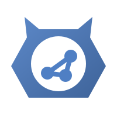

<div align="center">



# Orknux

**Open source agent orchestration, in a workspace your team runs itself.**

Workflows, agents, chat, research and the documents they produce - on your
models, behind your sign-in, on one server.

[](https://github.com/orknux/orknux-server/actions/workflows/ci.yml)
[](https://github.com/orknux/orknux-server/releases/latest)
[](https://hub.docker.com/r/orknux/orknux-server)
[](LICENSE)

[**orknux.io**](https://orknux.io) · [Manual](https://orknux.io/docs) ·
[Marketplace](https://orknux.io/market) · [Download](https://github.com/orknux/orknux-server/releases/latest) ·
[Reference](docs/reference.md)

<br>


</div>

## Try it in one command

```sh
docker run -d --name orknux -p 8080:8080 -v orknux-data:/var/lib/orknux orknux/orknux-one
docker logs orknux        # open http://localhost:8080 and sign in with the password it prints
```

Everything in one container, on a SQLite file - made for looking around. Or
install the **desktop app** for Windows (`.exe`, `.msi`) or Linux (`.deb`,
`.AppImage`) from the [latest release](https://github.com/orknux/orknux-server/releases/latest).

## What it does

<table>
<tr>
<td width="50%" valign="top">

### Workflows
Draw a process on a canvas: a trigger - a Slack mention, a schedule, a call to
the API - then functions, agents and conditions. Draft freely and publish when
it's ready. Runs are durable on Temporal, retried by policy and recorded step by
step, with what each step was given, what it returned and what it cost.

</td>
<td width="50%" valign="top">


</td>
</tr>
<tr>
<td valign="top">


</td>
<td valign="top">

### Agents and chat
Agents with their own model, tools, skills, memory and MCP servers, granted
exactly what they may touch. Chat with them, or let a workflow call them.
Includes Plan and Auto modes, reasoning effort, voice, pictures, and agents
asking other agents.

</td>
</tr>
<tr>
<td valign="top">

### Research
Ask a question and pick a depth. Orknux searches, reads, deepens and writes a
report with its sources, can review it before saving, and suggests what to
ask next.

</td>
<td valign="top">


</td>
</tr>
<tr>
<td valign="top">


</td>
<td valign="top">

### Design
Documents, diagrams, wireframes, images and videos, each with an AI chat beside
the editor and exports to PDF, ODT, SVG, PNG, HTML, MP4 and more. Several
people can edit at once.

</td>
</tr>
<tr>
<td valign="top">

### A tracker in every workspace
Issues with labels, assignees and history, and an **MCP endpoint** with access
tokens, so coding agents like Claude Code can file, read and close issues
without a browser.

</td>
<td valign="top">


</td>
</tr>
<tr>
<td valign="top">


</td>
<td valign="top">

### Plugins, sandboxed
Extend Orknux from the [marketplace](https://orknux.io/market) - GitHub, Slack
and more - without a server release. Plugins and your own functions run
in a sandbox with no host access, and reach the network only where an
administrator allows.

</td>
</tr>
</table>

### Built for running in-house

- **Your models.** OpenAI, Anthropic, Azure OpenAI, Ollama and llama.cpp, with
  prices per model and spend per session and run.
- **Your sign-in.** LDAP or Active Directory, OIDC, or local accounts, mapped
  to roles per workspace.
- **Accountable.** An audit log of every change, usage and error reports,
  session ratings, and flags for administrators.
- **Operable.** Monitoring, a Doctor page, tunable limits in Admin Settings,
  proxy rules for every outbound call, and signed self-update with rollback.
- **Two databases.** Postgres for a deployment, SQLite for one machine. Both
  are tested on every build.

## Install

| | |
|---|---|
| **Look around** | `docker run … orknux/orknux-one` above: one container, SQLite, nothing to configure |
| **Desktop** | Windows and Linux installers on the [releases page](https://github.com/orknux/orknux-server/releases/latest) |
| **Deploy** | [`deploy/compose.yaml`](deploy/compose.yaml) with Postgres, a directory and Temporal - see [deploy/README.md](deploy/README.md) |
| **Kubernetes** | One manifest in [deploy/kubernetes/](deploy/kubernetes/) |

```sh
curl -O https://raw.githubusercontent.com/orknux/orknux-server/main/deploy/compose.yaml
export ORKNUX_SECRET_KEY="$(openssl rand -base64 32)"   # keep it: it encrypts every stored credential
docker compose up -d                                     # http://localhost:8080 - alice / password
```

Every setting is listed on [Docker Hub](https://hub.docker.com/r/orknux/orknux-server).

## Build from source

Kotlin and Spring Boot on Java 25, a React interface in the
[orknux-ui](https://github.com/orknux/orknux-ui) submodule, built into one jar.

```sh
git clone --recurse-submodules https://github.com/orknux/orknux-server.git && cd orknux-server
./mvnw -f orkbox/pom.xml -pl orkbox-core -am install -DskipTests
docker compose up -d                       # Postgres, a directory and Temporal
ORKNUX_SECRET_KEY=... ./mvnw spring-boot:run -pl app -am
```

How it fits together, how to test it on both databases, and the reasoning
behind each part are in [docs/reference.md](docs/reference.md). Contributors
and coding agents should read [AGENTS.md](AGENTS.md) first.
[CHANGELOG.md](CHANGELOG.md) covers every release.

## Licence

[AGPL-3.0-or-later](LICENSE), with the attribution term in [NOTICE](NOTICE).
You may run, modify, host and sell it. If you offer a modified version over a
network, you must share that version's source. A commercial licence that lifts
both terms is available from the copyright holder.

Copyright © 2026 Michał Szymański.
